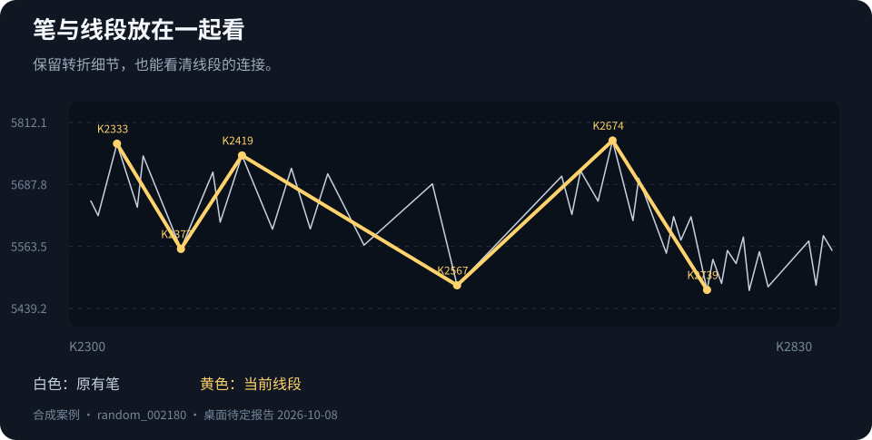
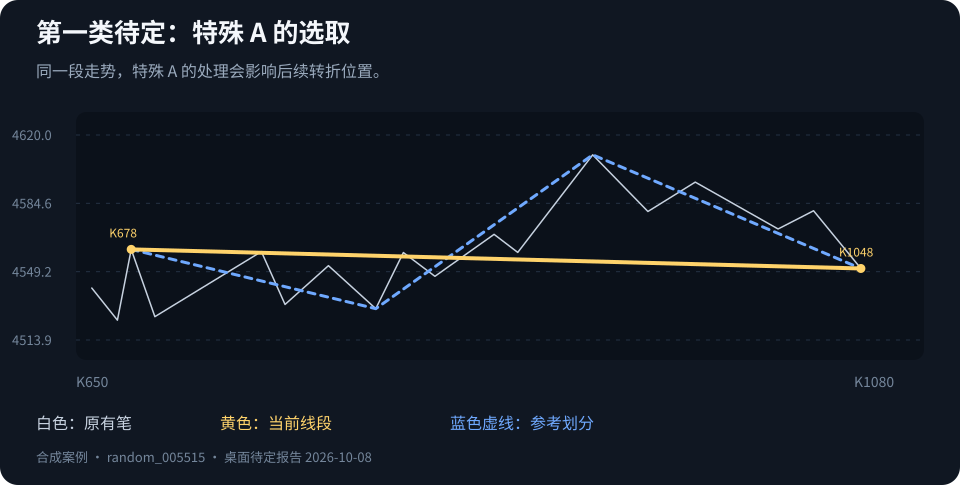
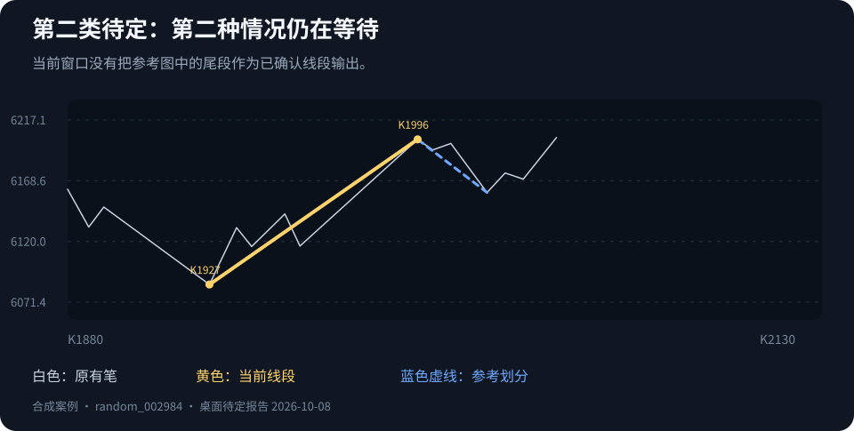
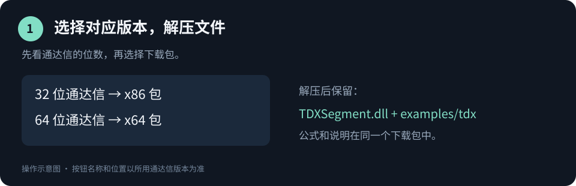

# 缠论线段自动划分

**自动画笔、连接线段，在通达信里直接看走势。**

[下载使用](https://github.com/foranarchocommunism-crypto/tdx-segment/releases/tag/v0.1.0-rc.2) · [案例展示](#案例展示) · [安装说明](#安装说明) · [待定情况](#待定情况) · [开发者入口](README.DEV.md)

## 功能简介

在通达信主图中自动标出笔和向上、向下线段。白色笔保留走势的转折，黄色线段显示已经确认的连接；走势尚未确认的尾部保留 K 线，方便继续观察。

| 你想看什么 | 怎么显示 |
| :--- | :--- |
| **笔的转折** | 自动识别顶底端点，用白线连接。 |
| **已确认线段** | 用黄色线段显示向上和向下走势。 |
| **还在发展的尾部** | 同时显示 K 线和笔，等后续走势给出确认。 |
| **更清爽的主图** | 可以隐藏已确认区域的历史笔，只保留线段。 |

本版把笔的计算一并放进了随包程序，公式负责显示。日常使用不用写代码。

## 案例展示

下面取自已有案例报告中的合成走势，保留原有笔线和线段位置。

白色是笔，黄色是当前线段。线段连接的是结构端点；它要等后续走势满足条件后才确认，因此转折位置和确认时间可能不同。

<strong>展开看两类待定的对照图</strong>

蓝色虚线是报告中的参考划分，黄色是当前划分。两图展示具体分歧，含义见下面的“待定情况”。

## 安装说明

### 1. 下载并解压

按**通达信自身的位数**选包：32 位通达信用 x86，64 位通达信用 x64。64 位 Windows 里也可能安装的是 32 位通达信。

| 通达信版本 | 下载 |
| :--- | :--- |
| 32 位 | [下载 x86 版](https://github.com/foranarchocommunism-crypto/tdx-segment/releases/download/v0.1.0-rc.2/TDXSegment-v0.1.0-rc.2-windows-x86.zip) |
| 64 位 | [下载 x64 版](https://github.com/foranarchocommunism-crypto/tdx-segment/releases/download/v0.1.0-rc.2/TDXSegment-v0.1.0-rc.2-windows-x64.zip) |

用户包只放程序、公式和使用说明。解压后，`TDXSegment.dll` 在最外层，五份公式在“公式”文件夹；双击 **`使用说明.html`** 就能查看图文步骤，无需配置开发环境。

### 2. 放好文件，绑定第 1 号

先退出通达信，将解压出来的 `TDXSegment.dll` 放入客户端允许的 DLL 文件夹。重新打开通达信，在公式管理器的 DLL 绑定入口选择这个文件，绑定到**第 1 号**并保存。

随包公式默认使用第 1 号。若这一号已经被其他工具占用，可选择空号，并将公式里的 `TDXDLL1` 全部改成相应号码，例如第 3 号用 `TDXDLL3`。更新旧版时需同时更换程序和公式。

### 3. 新建指标，先自检再看图

在公式管理器中新建技术指标，打开包内对应的公式文本，复制全部内容，测试通过后保存。

先使用 `01_DLL接口自检公式.txt` 检查是否接通。通过后，推荐使用 **`03_主图替换_待定区恢复K线版.txt`** 看完整主图；如果希望保留原主图，可以使用 `02_通达信笔识别与正式线段公式.txt` 叠加显示。

以上为操作示意图，具体按钮位置以所用通达信版本为准。[新建指标的官方图文说明](https://help.tdx.com.cn/gspt/docs/markdown/tdxgs-1d1k7b2r1ihug/tdxgs-gsbj/tdxgs-xjgssm.html)可供对照。

<strong>包内公式怎么选？</strong>

| 公式 | 用途 |
| :--- | :--- |
| 01 · 接口自检 | 第一次安装时检查是否接通。 |
| 02 · 笔与正式线段 | 保留原图，叠加笔与线段。 |
| 03 · 主图与待定区 K 线 | 看黄色线段、白色笔，以及尚未确认的尾部 K 线。 |
| 04 · 笔端点精准价格 | 检查端点价格和绘图位置。 |
| 05 · 笔计算迁移对照 | 比较本版笔计算与旧公式；几项差异数及加载错误都应为 0。 |

## 待定情况

目前保留两类尚有分歧的处理：

- **第一类：特殊 A 的选取。** 当局部走势没有按通常方式创新高或创新低时，某一笔是否作为特征序列元素，会影响分型和线段端点。本项目与参考划分在这类走势上仍有不同处理。
- **第二类：第二种情况中的新高问题。** 第二特征序列尚未确定时，又出现新的高点，怎样继续等待、取消或确认原端点，仍有分歧。

两类待定的划分规则本轮保持原样。图表末尾尚未确认的走势会继续保留 K 线和笔；这与上面两类规则分歧是不同的情况。

笔端点会随后续走势回填，增加或缩短历史范围也可能改变划分。本版笔计算迁移的通达信内对照仍待执行，可用 `05` 对照公式检查当前图表。

## 使用中遇到问题

**看不到线段：** 先检查 `01` 自检是否通过。若已经接通，尾部也可能还在等确认。

**提示加载失败：** 检查下载包是否与通达信位数对应、文件是否放对、绑定号码是否与公式一致。

**想反馈一段走势：** 到[问题反馈](https://github.com/foranarchocommunism-crypto/tdx-segment/issues)，附上图、所用版本和公式名称，标出你关注的转折位置。

---

[开发者说明](README.DEV.md)包含项目结构、构建、接口和测试记录。代码与随包文档使用 [MIT 开源许可](LICENSE)。
