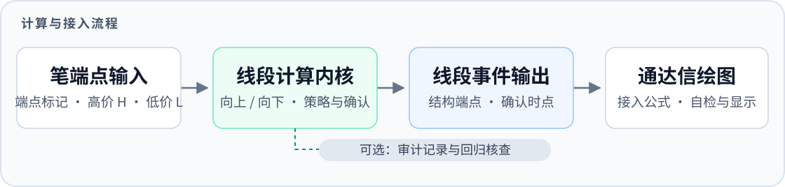

<div align="center">

# 缠论线段自动划分

**从笔端点到已确认线段，让划分过程可以追溯、可以验证。**

面向通达信的线段计算工具 · Windows x86 / x64 · C++ 内核与 Python 参考实现

[](https://github.com/foranarchocommunism-crypto/tdx-segment/actions/workflows/windows.yml) [](https://github.com/foranarchocommunism-crypto/tdx-segment/releases/tag/v0.1.0-rc.1) [](#下载与安装) [](#从源码构建) [](LICENSE)

[下载预发布版](https://github.com/foranarchocommunism-crypto/tdx-segment/releases/tag/v0.1.0-rc.1) · [快速上手](#快速上手) · [功能介绍](#功能介绍) · [文档导航](#文档导航) · [反馈问题](https://github.com/foranarchocommunism-crypto/tdx-segment/issues)

</div>

---

> **当前为预发布版 `v0.1.0-rc.1`。** 已通过本地工程验收和 GitHub 双架构构建测试；算法仍有待定情况与已知参考分歧，真实通达信客户端人工验收尚未完成。使用前请阅读[已知限制](#已知限制)。

<details>
<summary><strong>浏览目录</strong></summary>

- [项目简介](#项目简介)
- [功能介绍](#功能介绍)
- [下载与安装](#下载与安装)
- [快速上手](#快速上手)
- [四份接入公式](#四份接入公式)
- [输入与输出](#输入与输出)
- [从源码构建](#从源码构建)
- [验证状态](#验证状态)
- [已知限制](#已知限制)
- [常见问题](#常见问题)
- [项目结构](#项目结构)
- [文档导航](#文档导航)
- [参与贡献](#参与贡献)
- [许可证与致谢](#许可证与致谢)
- [English overview](#english-overview)

</details>

## 项目简介

**缠论线段自动划分**读取笔的顶底端点与 K 线高低价序列，按项目公开规则计算向上、向下线段，并输出逐 K 线的结构端点和确认事件。通过随包的通达信公式，可以将这些事件用于线段绘图、接线诊断与研究核查。

项目同时提供 C++ 计算内核、Windows DLL、Python 参考实现和合成回归工具，方便从图形结果追溯到输入、规则与确认时点。工程标识为 **TDXSegment**，仓库名为 `tdx-segment`，DLL 文件名为 `TDXSegment.dll`。



## 功能介绍

| 功能 | 说明 |
| :--- | :--- |
| **自动计算线段** | 接收顶底端点与高低价序列，恢复笔并计算已确认线段链。合法的待定区可以暂时没有线段事件。 |
| **向上 / 向下处理** | 使用上下镜像处理两种方向，保留线段连接关系与相应确认时点。 |
| **结构与确认分开表达** | 分别输出结构端点、确认事件和首段起点，便于绘图及核对事件发生顺序。 |
| **默认与实验策略** | 提供默认线段策略和实验恢复策略；策略差异有独立说明与回归检查。 |
| **接线自检与公式示例** | 提供独立自检入口及四份公式，覆盖常规绘图、主图显示和精准价格测试。 |
| **可执行参考与审计** | Python 参考实现覆盖其已有支持的语义；审计工具可用于核查候选、待定与恢复过程。 |
| **双架构构建与测试** | 提供 x86 / x64 DLL、CMake 与 PowerShell 入口，并在 GitHub Actions 中运行构建、测试和公开文件检查。 |

## 下载与安装

普通使用者可以直接下载 DLL 包，无需安装编译环境。

| 下载内容 | 适用场景 | 链接 |
| :--- | :--- | :--- |
| **Windows x86** | 32 位通达信进程 | [下载 x86 DLL 包](https://github.com/foranarchocommunism-crypto/tdx-segment/releases/download/v0.1.0-rc.1/TDXSegment-v0.1.0-rc.1-windows-x86.zip) |
| **Windows x64** | 64 位通达信进程 | [下载 x64 DLL 包](https://github.com/foranarchocommunism-crypto/tdx-segment/releases/download/v0.1.0-rc.1/TDXSegment-v0.1.0-rc.1-windows-x64.zip) |
| **完整源码** | 自行构建、核查与二次开发 | [下载源码包](https://github.com/foranarchocommunism-crypto/tdx-segment/releases/download/v0.1.0-rc.1/tdx-segment-v0.1.0-rc.1-source.zip) |

**DLL 位数必须与通达信进程位数一致。** 即使 Windows 是 64 位，32 位通达信仍应选择 x86 包。

二进制包包含 DLL、四份公式、使用说明、接口文档、MIT 许可证及版本信息。[发布页面](https://github.com/foranarchocommunism-crypto/tdx-segment/releases/tag/v0.1.0-rc.1)另提供 [SHA256SUMS.txt](https://github.com/foranarchocommunism-crypto/tdx-segment/releases/download/v0.1.0-rc.1/SHA256SUMS.txt)、[构建清单](https://github.com/foranarchocommunism-crypto/tdx-segment/releases/download/v0.1.0-rc.1/release-manifest.json)和[验证报告](https://github.com/foranarchocommunism-crypto/tdx-segment/releases/download/v0.1.0-rc.1/validation-report.json)，用于核对来源与文件哈希。

## 快速上手

1. **选择并解压 DLL 包。** 按通达信进程位数选择 x86 或 x64。更新已有 DLL 时，先退出客户端并备份旧文件。
2. **放置 DLL 并绑定槽位。** 将 `TDXSegment.dll` 放入客户端允许的 DLL 目录，在公式管理器中绑定到第 1 槽；具体目录与菜单随客户端版本而异。
3. **先运行接线自检。** 导入 [01 接口自检公式](examples/tdx/01_DLL接口自检公式.txt)，检查最后一根 K 线的接线提示、诊断码与端点回显。
4. **再接入线段公式。** 自检通过后使用 [02 笔识别与正式线段公式](examples/tdx/02_通达信笔识别与正式线段公式.txt)，或按需求选择下面的其他公式。

所有随包公式默认调用 **`TDXDLL1`**。如果绑定到其他槽位，必须同步更改公式中的调用名称。建议使用足够且一致的历史范围；初始锚点和上游笔端点都会影响结果。完整步骤与排查方法见[使用说明](docs/usage.md)。

### 四份接入公式

| 公式 | 用途 |
| :--- | :--- |
| [01 · DLL 接口自检](examples/tdx/01_DLL接口自检公式.txt) | 确认 DLL 加载、槽位接线与输入状态，优先用于排查问题。 |
| [02 · 笔识别与正式线段](examples/tdx/02_通达信笔识别与正式线段公式.txt) | 笔识别、默认线段策略与事件输出的主要接入示例。 |
| [03 · 主图与待定区 K 线](examples/tdx/03_主图替换_待定区恢复K线版.txt) | 主图显示及待定区 K 线恢复的接入方式。 |
| [04 · 精准价格测试模式](examples/tdx/04_笔端点精准价格测试模式.txt) | 用于核查笔端点价格与线段绘图的测试模式。 |

## 输入与输出

DLL 接收三条等长序列：

| 输入 | 含义 |
| :--- | :--- |
| 笔端点标记 | `1` 为顶端点，`-1` 为底端点，`0` 为非端点。 |
| 高价 `H` | 每根 K 线的最高价。 |
| 低价 `L` | 每根 K 线的最低价。 |

输出为逐 K 线的整数事件位掩码，由公式解析为向上 / 向下线段端点、确认事件、首段起点或输入错误。**结构端点位置与确认时点是不同的信息。**

| 函数号 | 用途 | 策略说明 |
| :---: | :--- | :--- |
| **1** | 默认线段计算 | 恢复门槛 `43/13/13`。 |
| **2** | 实验恢复策略 | 恢复门槛 `43/13/9`，切换会改变算法行为。 |
| **99** | 接线与输入自检 | 回显端点、探测初始锚点和输入诊断，不输出线段判断结果。 |

恢复策略见[补充说明](docs/recovery.md)。DLL 入口保持为 `RegisterTdxFunc`；公共 C++ 接口见 [tdx_segment.hpp](include/tdx_segment/tdx_segment.hpp)，事件位、错误码与调用协议见[接口说明](docs/interface.md)。

## 从源码构建

### 环境要求

| 工具 | 要求 |
| :--- | :--- |
| 系统 | Windows。 |
| C++ 工具链 | MSVC，支持 C++17，安装 C++ 桌面开发组件。 |
| CMake | 3.24 或更高；Visual Studio 2026 需要支持对应生成器的版本，可使用 VS 自带 CMake。 |
| Python | 运行测试时使用 Python 3.12，仅依赖标准库；仅构建 DLL 时不需要。 |

在 PowerShell 中获取源码：

```powershell
git clone https://github.com/foranarchocommunism-crypto/tdx-segment.git
cd tdx-segment
```

构建并测试 x86 / x64 Release：

```powershell
.\scripts\build.ps1
.\scripts\test.ps1
```

默认 DLL 输出位置：

```text
build/x86/Release/TDXSegment.dll
build/x64/Release/TDXSegment.dll
```

仅构建指定架构的 DLL：

```powershell
.\scripts\build.ps1 -Architecture x64 -DllOnly
```

脚本通过 `vswhere` 发现工具链，也支持显式指定工具与构建目录。手动 CMake、参数说明和打包入口见[构建文档](docs/build.md)。构建、测试与打包分开执行。

## 验证状态

以下结果对应 **`v0.1.0-rc.1` 发布提交 [`5873eeb`](https://github.com/foranarchocommunism-crypto/tdx-segment/commit/5873eebc27ec781f8646080ba32e85e3eb53d296)**；`main` 分支可继续更新文档，已发布源码与 DLL 以版本附件及构建清单为准。

| 验证项 | 结果与范围 |
| :--- | :--- |
| **本地双架构测试** | x86、x64 Release 各通过全部 **13 项 CTest**，包含 ABI、真实 DLL 加载与回调、异常输出、审计、范围、续算状态及两个既有性能门禁。 |
| **整理前后行为比较** | 固定种子 `20260828`，5,000 组随机输入及派生共 **51,455 个快照**；两架构、三策略的事件和完整审计输出零差异。 |
| **真实 DLL 回调比较** | 函数 `1/2/99`，每种架构 **154,365 次调用**，新旧输出零差异。 |
| **Python 参考对拍** | 已有支持的正式语义范围内，事件和审计对拍通过。 |
| **源码包独立构建** | 在含中文与空格的新目录中验证通过，不依赖原研究目录或私人行情。 |
| **GitHub 远程验证** | [首次双架构运行](https://github.com/foranarchocommunism-crypto/tdx-segment/actions/runs/38125105934)全部通过，各通过 **13 项 CTest**，同时通过公开文件、链接与公式检查。 |

完整本地记录见[发布验证报告](https://github.com/foranarchocommunism-crypto/tdx-segment/releases/download/v0.1.0-rc.1/validation-report.json)，当前分支的自动构建状态见 [Actions](https://github.com/foranarchocommunism-crypto/tdx-segment/actions)。测试通过说明相应验证集满足检查要求，不能替代所有输入的算法正确性证明。

## 已知限制

- **算法验收仍有缺口。** 历史最终组合全量验收未完成，历史三项 99% 算法一致性目标未达成；预发布不等于算法定稿。
- **实验恢复策略存在适用边界。** 本版保留既有判定规则与参考分歧，具体见[恢复策略](docs/recovery.md)和[验证边界](docs/validation.md)。
- **真实客户端人工验收尚未完成。** DLL 自加载与回调测试已通过，但本次在具体通达信版本中的公式导入、绘图、刷新和交互检查尚未执行。
- **结果依赖上游笔端点和输入历史。** 随包笔识别公式包含回填逻辑，不能将整套接入宣称为“完全不重绘”；改变端点、价格或历史范围可能影响计算结果。

## 常见问题

### 64 位 Windows 应该下载哪一版？

看**通达信进程**的位数。32 位客户端使用 x86，64 位客户端使用 x64，与 Windows 位数不必相同。

### 没有线段输出，是不是 DLL 没有工作？

不一定。合法输入尚未形成或确认线段时，可以没有线段事件。先用 `01` 自检公式与函数 `99` 确认加载、接线和输入，再检查是否处于待定状态。

### 可以直接切换到实验策略吗？

函数 `2` 与默认函数 `1` 的恢复门槛不同，可能改变结果。切换前阅读[恢复策略说明](docs/recovery.md)，并在同一输入范围上核对差异。

### DLL 加载失败，先检查什么？

依次检查进程位数、DLL 文件位置、绑定槽位、公式调用名称，以及客户端实际加载的版本。更新前退出客户端，使用发布清单核对文件哈希。详见[使用说明](docs/usage.md)。

## 项目结构

```text
tdx-segment/
├─ src/                 C++ 内核、内部头文件与 DLL 适配层
├─ include/tdx_segment/ 对外 C++ 接口
├─ compat/tdx/          最小通达信 ABI 兼容声明
├─ reference/           Python 参考实现
├─ tests/               自测、对拍、合成用例与回归工具
├─ examples/tdx/        四份通达信接入公式
├─ docs/                算法、架构、接口与验证文档
├─ scripts/             构建、测试、检查与打包入口
└─ .github/workflows/   Windows 双架构自动构建与测试
```

## 文档导航

| 想了解什么 | 从这里开始 |
| :--- | :--- |
| 如何加载 DLL、导入公式与排错 | [使用说明](docs/usage.md) |
| 如何构建、运行测试与打包 | [构建文档](docs/build.md) |
| 输入、函数号、事件位与错误码 | [接口协议](docs/interface.md) |
| 算法规则与实验恢复边界 | [算法核查](docs/algorithm.md) · [恢复策略](docs/recovery.md) |
| 模块划分与状态生命周期 | [架构说明](docs/architecture.md) |
| 从规则追溯到实现 | [规则与实现追溯](docs/traceability.md) |
| 哪些验证通过，哪些仍未完成 | [验证边界](docs/validation.md) |
| 公开源码的整理与来源 | [目录迁移](docs/migration.md) · [许可证与来源](docs/provenance.md) |
| 如何参与，版本有哪些变化 | [贡献指南](CONTRIBUTING.md) · [变更记录](CHANGELOG.md) |

## 参与贡献

欢迎通过 [Issues](https://github.com/foranarchocommunism-crypto/tdx-segment/issues) 反馈问题，或提交 Pull Request 改进文档、接入体验与可复现用例。

反馈时请说明客户端与 DLL 位数、版本、所用公式、复现步骤，以及期望结果和实际结果。算法问题优先提供**可公开的最小合成输入**及对应规则编号；不要上传私人行情、客户端配置、商业 DLL 或个人信息。代码贡献要求见[贡献指南](CONTRIBUTING.md)。

## 许可证与致谢

自有源码、文档及四份接入公式采用 [MIT 许可证](LICENSE)。

`Copyright (c) 2026 TDXSegment contributors`

`compat/tdx/` 是编译所需的最小兼容声明，**不是官方 SDK**；第三方名称、外部资料与替换入口的说明见[许可证与来源](docs/provenance.md)。

首页布局参考 [Best-README-Template](https://github.com/othneildrew/Best-README-Template) 的项目介绍、上手指南与文档导航组织方式；状态徽章使用 GitHub Actions 与 [Shields.io](https://shields.io/)。

## English overview

**缠论线段自动划分 (TDXSegment)** is a Windows C++17 DLL for automatic Chan-theory segment calculation in TongDaXin. It converts pen endpoint markers and high/low price arrays into segment endpoints and confirmation events. The repository includes x86/x64 builds, four integration formulas, a runnable Python reference, structural audit tools, and synthetic regression tests.

The current release, **v0.1.0-rc.1**, is a prerelease with documented algorithm limitations. Local engineering validation and the initial Windows CI run passed; historical full-corpus acceptance and manual client validation remain incomplete. See the [release](https://github.com/foranarchocommunism-crypto/tdx-segment/releases/tag/v0.1.0-rc.1), [build instructions](docs/build.md), and [validation boundaries](docs/validation.md). Licensed under [MIT](LICENSE).

<div align="center">

[返回顶部](#缠论线段自动划分)

</div>
