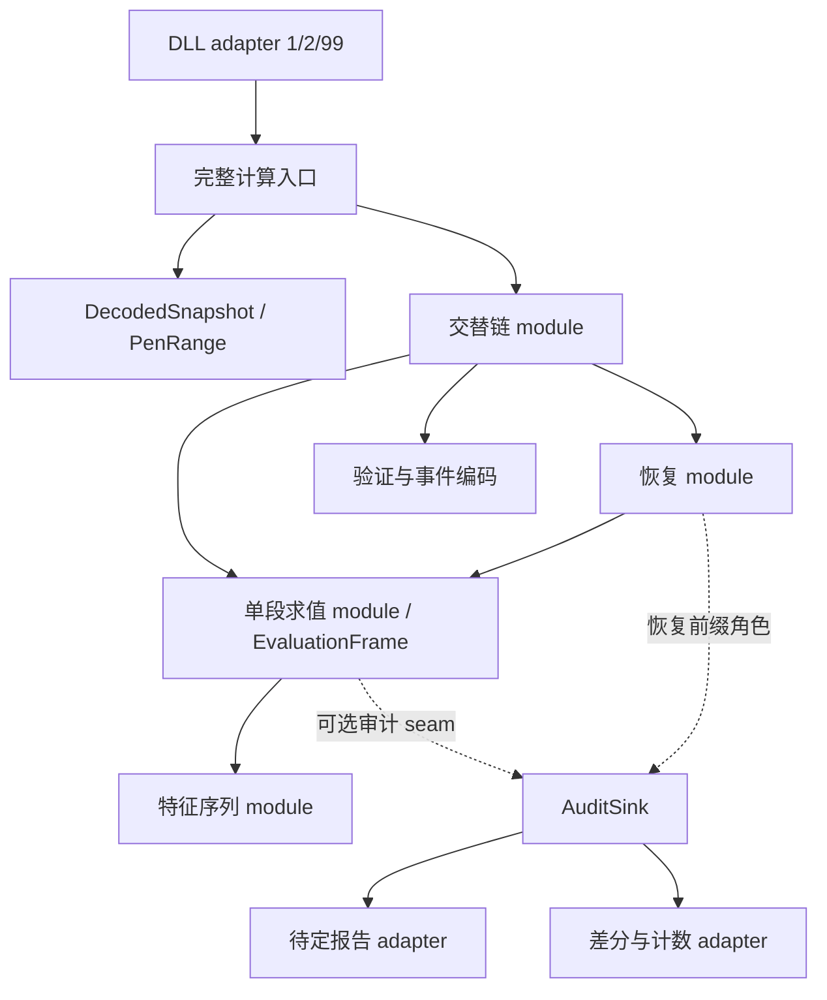
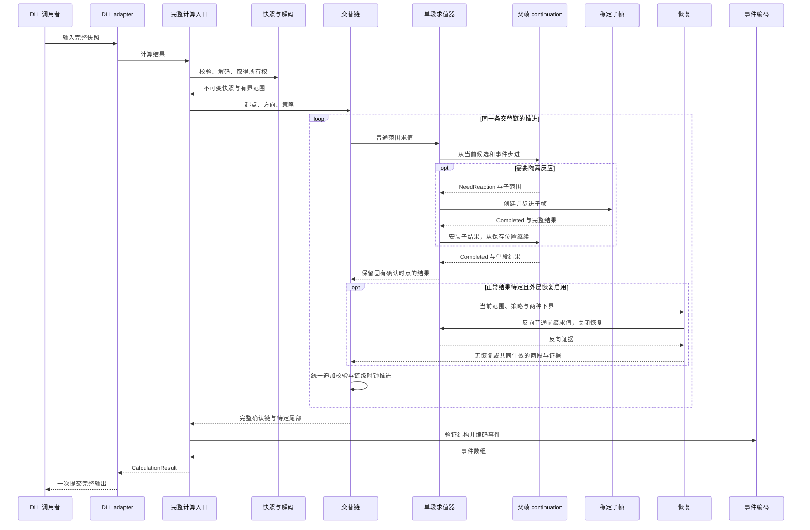

# 架构与状态所有权

## 兼容与计算入口

外部 interface 是 `include/tdx_segment/tdx_segment.hpp` 和厂商插件注册结构。保留 `TdxSeriesView`、`CalculationResult`、错误码、事件位、C++17，以及 `RegisterTdxFunc` 的字面导出名和调用约定。注册函数 1 使用正式策略 43/13/13，函数 2 使用实验策略 43/13/9，函数 99 提供接口探测。验证工具中的 OFF 路径关闭恢复。

一次完整快照计算拥有全部中间状态。DLL adapter 在计算、结构校验和事件编码完成后一次写回输出；异常被 adapter 拦截，错误输出覆盖整个目标范围，并设置既定错误位。调用之间没有共享求值缓存。审计 sink 属于调用者，仅在显式选择审计入口时使用。

## Module 与状态所有权

| Module | 隐藏的状态及 interface 契约 | 修改规则时的入口 |
|---|---|---|
| 快照与范围 | `DecodedSnapshot` 独占 K 线路径和笔元数据；`PenRange` 借用所有者，只允许访问范围右端以内的笔；切片与镜像保持原始 K 线编号，并明确局部索引与快照索引。解码器使用私有 `DecoderValidatedInput` tag 记录成功验证；手工输入保留完整验证。所有者移动后已有范围失效。 | `pen_snapshot.hpp/.cpp`、`input_decoder.cpp`；价格路径、镜像、非法手工输入和范围回归用例。 |
| 特征序列 | 包含标准化、来源跨度、最近／最高 A 与 A₂ 选择、相关索引由同一个 module 同步维护。两套序列保留各自判据。 | `feature_sequences.hpp/.cpp`；double、EPS 并列与包含回溯测试。 |
| 单段求值 | `EvaluationFrame` 保存候选推进、资格累计、后继候选、分支等待和嵌套反应状态；`CandidateContinuation` 与 `TrendAContinuation` 保存暂停位置。根帧位于自动存储期，只有嵌套子帧使用稳定堆地址。子结果进入当前上下文缓存后，父帧沿用同一候选与事件 continuation。 | `segment_evaluator.cpp`；单段时序、深嵌套与无重放计数；走势 A 同事件第二情况优先测试。 |
| 交替链 | 独占共享端点、方向、链级确认时点与后继候选下界；统一追加流程验证方向、结构连接及时钟。固有确认时点不被链级时钟覆盖。 | `segment_engine.cpp`；相邻线段与历史前缀测试。 |
| 恢复 | 只在外层链启用，按策略门槛、正常确认优先及反向证书选择成对结果。普通单段与嵌套求值均关闭恢复。缓存限制在当前快照及求值作用域，并在作用域结束时释放。 | `long_stall_recovery.cpp`；43/13/13、43/13/9、OFF 对比；被否定 T、活动候选阻挡及共同生效测试。 |
| 审计 | `segment_audit.hpp` 是私有 seam；身份包含根起点、方向、深度、范围、候选下界和角色。默认空 sink 不创建记录容器。 | 待定报告 runner、审计开关与并发等价测试。 |

这些 module 的 depth 来自隐藏数据生命周期和规则推进，而不是增加逐函数包装。特征序列修改具有 locality；报告与差分两个实际 adapter 共用审计 seam，提供 leverage。新增规则应进入对应 module，并以完整入口或真实私有 interface 验证；不要通过字符串修改生产源码来构造测试。

## 单次调用与嵌套求值时序

下图中的父帧与子帧由同一个求值器串行调度，不表示额外线程。
根帧使用自动存储期，子帧具有稳定地址；帧保存当前候选、事件游标和分支等待状态。
子范围返回后，求值器把结果交给原 continuation，已经追加的特征前缀和已经处理的事件继续使用。

`AuditSink` 只观察这条调用内的求值与恢复事件，不拥有快照或求值缓存。
失败由既定错误结果或 adapter 的异常边界处理；输出提交前不向宿主暴露局部计算。
continuation 回归同时检查请求与恢复次数一致、每个帧只启动一次、父候选和父事件重放次数为零。
完整审计生命周期回归则先独立保存结果与所有回调字段、顺序，再核对交错调用及并发调用；
同长度变尾输入保持原始长度和解码笔数，两种方向与三种策略都参与比较。

只有 `DecodePens` 是可信解码 tag 的友元入口，公开的手工快照构造和借用笔流不能自行授予信任。手工范围仍检查原始编号、连续性和价格路径；成功解码的不可变范围复用所有者验证结果。可信标记用于省去重复验证，不改变异常输入的验证契约。`input_decoder.cpp`、`event_encoder.cpp` 分别隐藏解码与事件输出检查；DLL adapter 仍承担原子写回。

公开验证和发布绑定方式见 [验证说明](../release/validation.md)。

## 笔公式模块

`pen_formula.cpp`提供两个无状态的深入口，`formula_series.hpp`只包含原笔公式实际使用的私有运算。它与线段解码、评估、审计和恢复模块分开；增加笔计算不会改变既有线段状态的生命周期。宿主适配器复用模板化的完整计算后写回边界，并保留受控异常/长度测试。新增公共头文件单独命名输入类型，避免借用旧结构体造成参数含义混淆。
